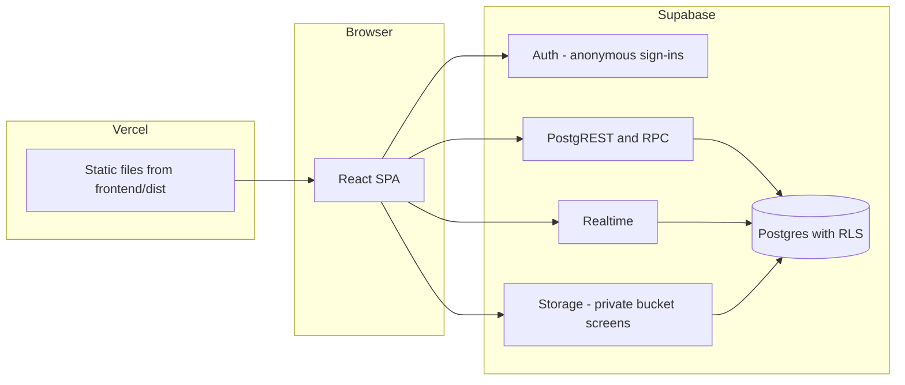
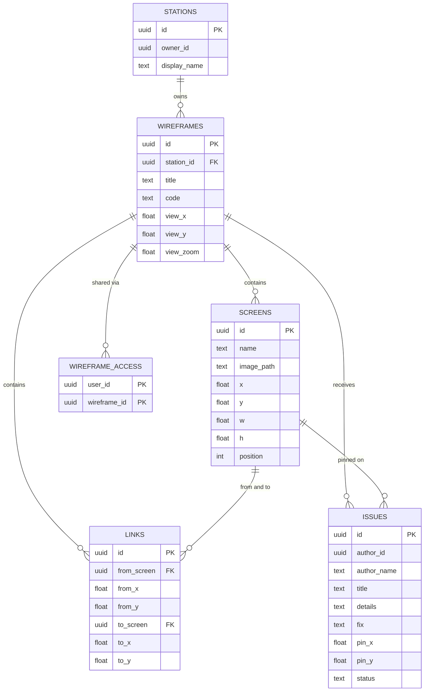

# Architecture

Tracewire is a single-page React app that talks directly to Supabase. There is no custom application server: security lives in Postgres row-level security (RLS), and a few server-side functions handle the operations that must not be done by the client (generating codes, granting access).

## System overview



Vercel serves only static files. Every data request goes from the browser to Supabase with the user's anonymous JWT, and Postgres decides what that user may see or change.

## Identity

On first load the app calls `signInAnonymously()`. The session persists in the browser (`localStorage` key `tracewire.auth`). Each identity gets one row in `stations` (via the `ensure_station` RPC), which represents the user's workspace and ownership.

- Owner: the user whose `auth.uid()` equals `stations.owner_id` for a wireframe's station.
- Reviewer: any other user who has joined the wireframe with its code.

Consequence: identity is the browser session. Clearing site data creates a new identity.

## Data model



Key decisions:

- **Wires and pins use normalized coordinates.** `from_x`, `from_y`, `to_x`, `to_y`, `pin_x` and `pin_y` are fractions (0 to 1) of the page they belong to. Moving or resizing a page keeps its wires and pins attached to the same spot on the image.
- **Pages use world coordinates.** `screens.x`, `y`, `w`, `h` are positions on an unbounded canvas. The wireframe stores its own `view_x`, `view_y` and `view_zoom` so it reopens where it was left.
- **`station_id` is repeated on child tables** (screens, links, issues). It makes ownership checks in policies a single indexed comparison, and the storage path uses it too.
- **Cascades.** Deleting a wireframe cascades to screens, links, issues and access rows. Deleting a page cascades to its wires and issues.
- **Unique titles.** A unique index on `(station_id, lower(btrim(title)))` blocks duplicate names per owner, ignoring case and extra spaces.

## Access control

All policies are in `backend/migrations`. Three `security definer` helper functions keep policies short and avoid recursive policy evaluation:

| Function | Meaning |
|---|---|
| `owns_station(sid)` | The caller owns this station |
| `can_read_wireframe(wid)` | The caller owns the wireframe's station, or has a row in `wireframe_access` for it |
| `can_read_station(sid)` | The caller owns the station, or has joined any wireframe in it |

| Action | Owner | Reviewer with code | Anyone else |
|---|---|---|---|
| Read wireframe, pages, wires, issues, images | Yes | Yes | No |
| Create, edit, delete wireframes, pages, wires | Yes | No | No |
| Add an issue | Yes | Yes | No |
| Edit or delete an issue | Any | Only their own | No |
| Mark an issue resolved | Yes | Only their own issues | No |
| Read the code of a wireframe | Yes | Yes (they typed it) | No |

Codes and joining:

- A DB trigger (`wireframes_set_code`) generates every wireframe's code on insert, so the client cannot choose one.
- Column-level grants only allow clients to update `title`, `view_x`, `view_y`, `view_zoom` on `wireframes`. The code can only change through `regenerate_wireframe_code`.
- `join_wireframe(code)` normalizes the input, finds the wireframe and inserts a `wireframe_access` row for the caller. A wrong code raises `code_not_found`. The owner's own code does not create an access row.
- `regenerate_wireframe_code(id)` checks ownership, creates a new code and deletes all access rows for that wireframe, which immediately revokes every reviewer.
- Code format: `TW-` plus 10 characters from a 31-character alphabet without look-alike characters, built from random UUID bytes.

## Storage and the image pipeline

- Bucket `screens` is private. Object path: `{station_id}/{wireframe_id}/{uuid}.{ext}`.
- Storage policies read the wireframe id from the second folder segment: reading follows `can_read_wireframe`, writing and deleting require `owns_station` on the first segment.
- Before upload, the browser downscales images so the longest side is at most 2000 px and encodes WebP at quality 0.82. Small web-ready files (WebP, JPEG or PNG up to 300 KB, within the size limit) are uploaded unchanged.
- Uploads run three at a time. If any upload or the final insert fails, every file uploaded in that batch is removed.
- Images are shown through signed URLs valid for 6 hours, cached in memory and refreshed a minute before expiry.

## Frontend structure

```
src/
  main.jsx, App.jsx        Router, providers, global shortcuts
  context.jsx              Session bootstrap, station, toasts
  lib/
    supabase.js            Client configuration
    api.js                 All database, RPC and storage calls
    image.js               Resize and encode before upload
    geometry.js            Hit testing and the wire curve
    format.js              Dates, clipboard, safe localStorage
  hooks/useTheme.js        Dark and light theme
  pages/
    Home.jsx               Workspace, wireframe grid, join form, shared list
    Work.jsx               Loads one wireframe, owner or reviewer mode
  components/
    WireCanvas.jsx         The canvas: pan, zoom, pages, wires, pins
    IssueForm.jsx          Issue creation form
    IssueDrawer.jsx        Issue list and detail view
    ShareModal.jsx         Code, invite link, regenerate
    CreateWireframeModal.jsx, WorkCard.jsx, Modal.jsx, Header.jsx,
    HintsPanel.jsx, Icons.jsx
  App.css                  All styles, theme tokens at the top
```

All styling lives in `App.css`. Light and dark themes are CSS custom properties on `:root` and `:root[data-theme='light']`. A small inline script in `index.html` sets the theme before first paint to avoid a flash.

## The canvas

`WireCanvas` renders a transformed `stage` div (`translate` and `scale` from `view`) containing the page images, one SVG layer for wires and a layer of pins. Because the stage is scaled, labels, wire handles, arrowheads and pins apply `scale(1 / zoom)` so they stay a constant on-screen size.

**Input model.** One set of pointer events handles mouse, touch and pen:

- Left-drag on empty space pans. Middle-drag on a page moves it (owner). With **Move images** on, left-drag moves pages.
- Two pointers form a pinch gesture. A 520 ms press with little movement on touch acts as a right-click.
- Right-click (or long-press) means: owner starts a wire from that point on the page under the cursor; reviewer opens the issue form with a pin at that point.
- The wheel listener is attached natively with `passive: false`, because React's synthetic wheel handler cannot call `preventDefault`.

**Wire creation.** The pending wire follows the cursor. Dropping on another page stores the target as normalized coordinates. Dropping on empty space, pressing `Esc` or right-clicking again cancels it. Dragging the ball or the arrow of an existing wire re-attaches that end to whichever page it is released on, or snaps back if released on empty space.

**Wire shape.** A cubic Bezier is computed in `geometry.js`. The arrow angle comes from the last control point to the end point, and the midpoint hosts the remove button.

## Saving

| Data | When it saves |
|---|---|
| Wires, issues, page names | Immediately on the action, with optimistic UI and rollback on error |
| Page positions and view (pan and zoom) | Debounced 700 ms after the last change, owner only |

The debounced save also flushes on `pagehide`, when the tab becomes hidden, and when leaving the page. On failure the changes stay marked dirty and retry every 5 seconds, and the toolbar shows the state (Saved, Unsaved changes, Saving, Save failed).

## Realtime

The app subscribes to Postgres changes filtered by `wireframe_id`:

- Owner: `issues`, so reviewers' pins appear live. Local edits are not echoed back over realtime, so dragging never fights an incoming update.
- Reviewer: `issues`, `screens` and `links`, so they follow the owner's edits.

Events are debounced by 350 ms and trigger a refetch rather than patching state, which keeps the logic simple and correct. Realtime respects RLS, so subscribers only receive rows they could read. The tables use `replica identity full` so updates and deletes carry enough data.

## Deletion

- Deleting a wireframe: read its image paths, delete the row (cascades to everything else), then remove the files from storage.
- Deleting a page: delete the row (cascades to its wires and issues), then remove its file.
- Deleting an issue: delete the row.
- Creating a wireframe inserts the row first, so a duplicate name fails before any image is uploaded. If uploading fails afterwards, the row and uploaded files are rolled back.

## Deployment

- `frontend/` builds to static files (`vite build`), hosted on Vercel with Root Directory set to `frontend`.
- `frontend/vercel.json` rewrites all paths to `index.html` for client-side routing.
- Configuration is two public environment variables, `VITE_SUPABASE_URL` and `VITE_SUPABASE_ANON_KEY`. They are inlined at build time, so changing them requires a redeploy.
- The backend is a Supabase project initialized by `backend/migrations/*.sql`.

## Reliability and safety (v1.0)

- **Guaranteed file cleanup.** Database triggers write the path of every deleted page image or reply image into `storage_trash`. The owner's app empties that queue on start and after deletes, so files are removed even when a reviewer made the deletion or the browser closed halfway.
- **Unread tracking.** `issue_reads` stores when each person last opened an issue. `unread_issues()` returns issues that are new to the caller or have replies from others since they last read. Realtime inserts show a toast and update the tab title.
- **Portable identity.** Anonymous users can link an email with `updateUser({ email })`, which keeps the same user id. Signing in on another device with a magic link loads the same workspace.
- **Individual access control.** `wireframe_blocks` plus `set_reviewer_access` remove one reviewer without changing the code. `join_wireframe` refuses blocked users.
- **Abuse limits.** Triggers cap wireframes per workspace (50), pages per wireframe (60), issues per wireframe (300), reply images per person per wireframe (40), and rate-limit issues, replies and reactions per minute.
- **Consistency.** Triggers verify that pages, wires and issues reference the same wireframe, and column-level grants limit which fields clients can change.
- **Pagination.** Every list is read in pages of 1000 rows.
- **Fresh image links.** Signed URLs last 2 hours and are renewed every 40 minutes, on tab focus, and when an image fails to load.
- **Delivery.** `vercel.json` sets a strict Content Security Policy (no inline scripts), clickjacking protection and long-lived caching for hashed assets.

## Known limitations

- Without a linked email, ownership is tied to the browser profile.
- Reviewers are identified by anonymous sessions, so a removed reviewer can return only by getting a new code.
- Two owner devices editing at the same moment resolve as last write wins, but each re-syncs when its tab regains focus.
- Reply images that a reviewer deletes are physically removed the next time the owner opens the app.
- Magic-link email delivery depends on your SMTP provider and its limits.