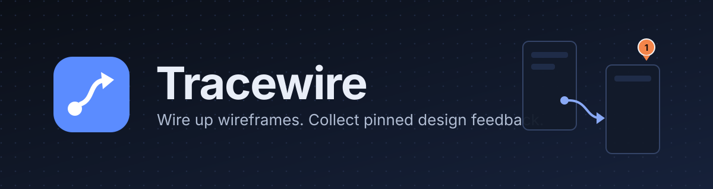

<p align="center"></p>

# Tracewire

Wire up wireframes and collect pinned design feedback.

Upload screen images, connect them with wires (a ball at the start, an arrow at the end) to show how users move between screens, and share the wireframe with reviewers and teammates. People right-click where they see a problem and file a pinned issue. The owner and reviewers reply to each other in a Reddit-style thread, with images, emojis and reactions. Everything updates live.

## Features

**Building**
- **Wires.** Right-click a page to start a wire, left-click another page to drop it. Drag either end to re-attach it. Dropping on empty space cancels.
- **Notes.** Write a note on any wire or any page image.
- **Reset layout.** Every page remembers its original position. One button puts them all back.
- **Autosave.** Page positions save automatically, including when you leave the page.
- **Rename and unique titles.** Click a title to rename it. Two wireframes in one workspace cannot share a name.

**Sharing and collaboration**
- **Invite people by email** as Viewer, Commenter or Editor, like Google Drive.
- **General access.** Keep a wireframe Restricted, or let anyone with its code open it as Viewer, Commenter or Editor. Changes apply instantly to everyone who already joined.
- **Per-wireframe codes.** Every wireframe has its own code. Generate a new one to cut off everyone who used the old one.
- **Manage people.** Change a role, remove one person, or restore someone you removed.
- **Live collaboration.** Several editors can work at once. Changes appear within a second or two, and avatars show who is viewing right now.

**Feedback**
- **Pinned issues** with reporter name, title, explanation, suggested fix, date and time. Editors can mark them resolved. Search and filter them.
- **Threaded replies.** The owner and reviewers reply to the issue and to each other. Threads nest and collapse.
- **Images, emojis and reactions** on replies. Paste an image, pick emojis, react with a smiley. GIFs keep their animation.
- **Edit and delete** your own replies.
- **Unread tracking.** Blue dots, "new" badges, toasts for new activity and a count in the tab title.

**Account and data**
- **No sign-up to start.** Everyone gets an automatic anonymous session.
- **Link an email** to keep your wireframes, sign in on any device and open wireframes shared with that email.
- **Export** any wireframe as a Markdown report or a JSON backup.
- **Erase my data** deletes everything you own or wrote.
- **Clean deletes.** Deleting a wireframe, page, issue or reply removes its stored files too, guaranteed by a database queue.

**Polish**
- Dark and light themes, responsive layout, touch support (long-press, pinch to zoom), built-in hints, offline banner, error screen, installable as an app.

## Roles

| Role | What they can do |
|---|---|
| Viewer | See pages, wires, notes, issues and replies |
| Commenter | Everything a viewer can, plus report issues, reply and react |
| Editor | Everything a commenter can, plus add, move and delete pages, draw and adjust wires, write notes, resolve issues and reset the layout |
| Owner | Everything an editor can, plus rename, delete, share, manage people and generate new codes |

A person's role is the higher of their email invite and the general access role.

## How sharing works

1. Open a wireframe and click **Share**.
2. **Add people:** type an email, pick a role and click Invite. They must sign in with that exact email. Send them the link (Copy link, or Email the link).
3. **General access:** choose **Restricted** (only invited people) or **Anyone with the code** with a role. New wireframes start Restricted.
4. If you chose Anyone with the code, send the code or the invite link. The person pastes it under **Open a shared wireframe**.

An invitee who has never used Tracewire opens the link, clicks the account icon and links that email. Someone who already has an account signs in with it. The app does not send emails itself.

## Controls

| Action | Desktop | Touch |
|---|---|---|
| Start a wire (editor) | Right-click a page | Long-press a page |
| Drop a wire | Left-click another page | Release or tap on another page |
| Cancel a wire | `Esc`, or click empty space | Tap empty space |
| Adjust a wire | Drag its ball or arrow | Drag its ball or arrow |
| Remove a wire | Click it, then `Delete` or the red button | Tap it, then the red button |
| Note on a wire | Right-click the wire | Tap the wire, then the note button |
| Note on a page | Double-click it, or the note icon beside its name | Double-tap it, or the note icon |
| Move an image (editor) | Middle-mouse drag, or turn on **Move images** and drag | Turn on **Move images** and drag |
| Reset page positions (editor) | **Reset layout** | **Reset layout** |
| Report an issue (commenter) | Right-click where the problem is | Long-press where the problem is |
| Open an issue and reply | Click its pin | Tap its pin |
| Pan | Drag empty space, or scroll | Drag |
| Zoom | `Ctrl` + scroll, or `+` and `-` | Pinch |
| Fit everything | `0` | **Fit** button |
| Show hints | `?` or the **Hints** button | **Hints** button |

## Tech stack

- Frontend: React 18, Vite, React Router, plain CSS (`frontend/src/App.css`), Vitest
- Backend: Supabase (Postgres with row-level security, anonymous and email auth, private storage, realtime and presence)
- Hosting: Vercel (frontend), Supabase (backend)
- CI: GitHub Actions (tests and build)

## Repository layout

```
frontend/         React app (deploy this)
backend/          Supabase SQL migrations and setup guide
docs/             Banner assets
.github/          CI workflow
ARCHITECTURE.md   How the system works
```

## Getting started

Requires Node 20.19 or newer and a free Supabase account.

**1. Backend.** Follow [backend/README.md](backend/README.md): create the project, configure Auth and run the six migrations in order.

**2. Frontend.**

```bash
cd frontend
npm install
cp .env.example .env      # on Windows PowerShell: Copy-Item .env.example .env
```

Fill in `frontend/.env`:

```
VITE_SUPABASE_URL=https://YOUR-PROJECT-REF.supabase.co
VITE_SUPABASE_ANON_KEY=YOUR-ANON-OR-PUBLISHABLE-KEY
```

```bash
npm run dev
```

Open http://localhost:5173.

**Trying two people on one machine.** Use a normal window as the owner and a private window as the second person. New wireframes are Restricted, so in Share either set General access to "Anyone with the code" and paste the code in the private window, or invite an email and link that email in the private window.

## Scripts

Run these inside `frontend/`.

| Command | What it does |
|---|---|
| `npm run dev` | Start the dev server |
| `npm test` | Run the unit tests |
| `npm run build` | Production build into `dist/` |
| `npm run preview` | Serve the production build locally |

## Deployment

**Frontend on Vercel**

1. Push the repository to GitHub.
2. Import it in Vercel and set **Root Directory** to `frontend`.
3. Framework preset: Vite. Build command: `npm run build`. Output directory: `dist`.
4. Add the environment variables `VITE_SUPABASE_URL` and `VITE_SUPABASE_ANON_KEY`.
5. Deploy. `frontend/vercel.json` rewrites every route to `index.html` and sets security headers, including a strict Content Security Policy.

**Supabase settings for production** (see [backend/README.md](backend/README.md)):
- Set the **Site URL** to your Vercel URL and add it to the Redirect URLs.
- Keep **Confirm email** turned on.
- Configure a custom **SMTP** provider, because the built-in email sender allows only a few emails per hour.

## Security model

- All access control is enforced in the database by row-level security. The anon key alone cannot read anything.
- One database function, `wireframe_role`, decides a person's role from ownership, a confirmed-email invite and the general access setting. Every table policy and storage rule is built from it.
- Invites match the signed-in user's **confirmed** email only. With "Confirm email" on, nobody can claim an address they do not own.
- Wireframe codes are generated on the server. Clients cannot choose or change them except through `regenerate_wireframe_code`.
- Column-level permissions limit which fields each role can change, and database triggers check that pages, wires and issues belong to the same wireframe.
- Quotas and rate limits stop abuse: 50 wireframes per workspace, 60 pages per wireframe, 300 issues per wireframe, 50 invites per wireframe, and per-minute limits on issues, replies and reactions.
- Images live in private buckets and are served through short-lived signed URLs that refresh automatically.
- The service_role key is never used or needed.

## Limitations

- **No automatic invite emails.** Supabase only sends sign-in and confirmation emails. The Share dialog gives you a link and a prefilled email to send.
- **Exact email match.** Invites match the address as typed (case ignored). Gmail dots and `+tags` count as different addresses.
- **Without a linked email, ownership is tied to the browser profile.** Clearing site data loses access. Link an email in Account to avoid this.
- **Same-moment edits.** Two editors changing the very same item at the same instant resolve as last write wins. Different items never conflict.
- **Role changes reach an open screen within about a minute** or when the person returns to the tab. The database enforces them immediately.
- **Only the owner's pan and zoom is saved** with the wireframe. Everyone else keeps their own view.
- **Reply image cleanup is queued.** Files deleted by a reviewer are removed the next time the owner or an editor opens the app.
- **Free-tier limits.** Supabase's free plan caps storage and bandwidth.

## Further reading

See [ARCHITECTURE.md](ARCHITECTURE.md) for the data model, access control, data flows and design decisions.