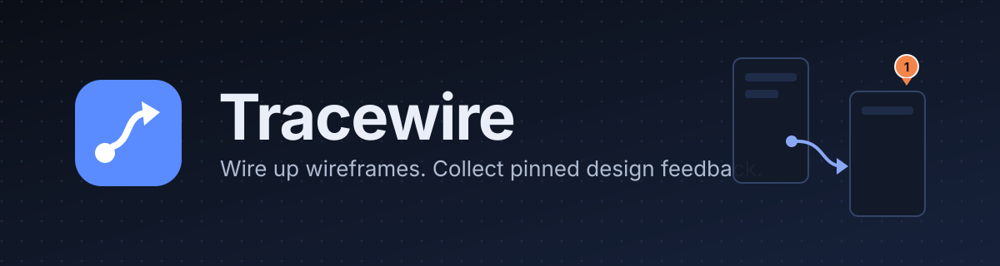

<p align="center"></p>

# Tracewire

Wire up wireframes and collect pinned design feedback.

Tracewire lets you upload screen images, connect them with wires (a ball at the start and an arrow at the end) to show how users move between screens, and share each wireframe with a reviewer through its own private code. The reviewer right-clicks where they see a problem and files a pinned issue with a title, explanation and suggested fix. You see their pins appear live.

## Features

- **Per-wireframe codes.** Every wireframe has its own code, so a reviewer only sees what you choose to share. Generate a new code at any time to cut off everyone who used the old one.
- **Wires.** Right-click a page to start a wire, left-click another page to drop it. Drag either end to re-attach it. Dropping on empty space cancels.
- **Pinned issues.** Reviewers enter their name, a problem title, an explanation and a suggested fix. Each issue shows who reported it and when, and the owner can mark it resolved.
- **Live updates.** New issues appear on the owner's screen without refreshing. Reviewers see page and wire changes live.
- **Autosave.** Image positions, pan and zoom save automatically, including when you leave the page.
- **Clean deletes.** Deleting a wireframe, page or issue removes its rows and its stored image files.
- **Unique titles.** You cannot create two wireframes with the same name.
- **No sign-up.** Everyone gets an automatic anonymous session.
- **Dark and light themes**, responsive layout, touch support (long-press, pinch to zoom), and built-in hints.

## How sharing works

1. Open a wireframe and click **Share** (or the link icon on its card) to see its code.
2. Send the code or the invite link to a reviewer.
3. The reviewer pastes the code under **Open a shared wireframe** and sees only that wireframe.

## Controls

| Action | Desktop | Touch |
|---|---|---|
| Start a wire (owner) | Right-click a page | Long-press a page |
| Drop a wire | Left-click another page | Release or tap on another page |
| Cancel a wire | `Esc`, or click empty space | Tap empty space |
| Adjust a wire | Drag its ball or arrow | Drag its ball or arrow |
| Remove a wire | Click it, then `Delete` or the red button | Tap it, then the red button |
| Move an image (owner) | Middle-mouse drag, or turn on **Move images** and drag | Turn on **Move images** and drag |
| Pan | Drag empty space, or scroll | Drag |
| Zoom | `Ctrl` + scroll, or `+` and `-` | Pinch |
| Fit everything | `0` | **Fit** button |
| Report an issue (reviewer) | Right-click where the problem is | Long-press where the problem is |
| Open an issue | Click its pin | Tap its pin |
| Show hints | `?` or the **Hints** button | **Hints** button |

## Tech stack

- Frontend: React 18, Vite, React Router, plain CSS (`src/App.css`)
- Backend: Supabase (Postgres with row-level security, anonymous auth, private storage, realtime)
- Hosting: Vercel (frontend), Supabase (backend)

## Repository layout

```
frontend/   React app (deploy this)
backend/    Supabase SQL migrations and setup guide
docs/       Banner assets
ARCHITECTURE.md   How the system works
```

## Getting started

Requires Node 20.19 or newer and a free Supabase account.

**1. Backend.** Follow [backend/README.md](backend/README.md) to create the Supabase project, enable anonymous sign-ins and run the two migrations.

**2. Frontend.**

```bash
cd frontend
npm install
cp .env.example .env      # on Windows PowerShell: Copy-Item .env.example .env
```

Fill in `.env`:

```
VITE_SUPABASE_URL=https://YOUR-PROJECT-REF.supabase.co
VITE_SUPABASE_ANON_KEY=YOUR-ANON-OR-PUBLISHABLE-KEY
```

```bash
npm run dev
```

Open http://localhost:5173. To test the two roles on one machine, use a normal window as the owner and a private window as the reviewer.

## Scripts

Run these inside `frontend/`.

| Command | What it does |
|---|---|
| `npm run dev` | Start the dev server |
| `npm run build` | Production build into `dist/` |
| `npm run preview` | Serve the production build locally |

## Deployment

**Frontend on Vercel**

1. Push the repository to GitHub.
2. Import it in Vercel and set **Root Directory** to `frontend`.
3. Framework preset: Vite. Build command: `npm run build`. Output directory: `dist`.
4. Add the environment variables `VITE_SUPABASE_URL` and `VITE_SUPABASE_ANON_KEY`.
5. Deploy. `frontend/vercel.json` rewrites every route to `index.html`, so deep links and refreshes work.

**Backend on Supabase.** Nothing to deploy beyond running the migrations once.

## Security model

- All access control is enforced in the database by row-level security. The anon key alone cannot read anything.
- A wireframe's code is the only way to gain read access to it. Codes are generated on the server and cannot be changed from the client except through `regenerate_wireframe_code`.
- Reviewers can read the wireframe, add issues, and edit or delete their own issues. Only the owner can change pages, wires and codes, or resolve issues.
- Images are in a private bucket and are served through short-lived signed URLs.
- The service_role key is never used or needed.

## Limitations

- Ownership is tied to the anonymous session in the browser. If you clear site data or switch browser profiles, you lose edit access to your wireframes. Keep using the same browser profile.
- Anyone who has a wireframe's code can open it, and can pass the code on. Use **Generate new code** to revoke access.

## Further reading

See [ARCHITECTURE.md](ARCHITECTURE.md) for the data model, access control, data flows and design decisions.