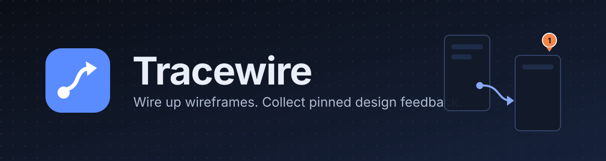

# Banner

The project banner lives in `docs/banner.svg` (1200 x 320, dark background, works on GitHub in both themes).



## Use it in the README

```markdown
<p align="center"></p>
```

## Editing

- Colors: background `#0b0f17` to `#16213a`, accent `#5b8cff`, wire `#8fb0ff`, pin `#ff8a4c`. These match the app's dark theme tokens in `frontend/src/App.css`.
- Text uses Inter with Segoe UI and Arial as fallbacks. GitHub does not load web fonts inside SVG images, so it will render with the fallback.
- For a GitHub social preview (1280 x 640 PNG), open `banner.svg` in a browser, resize the window, and screenshot, or export it from any vector editor.